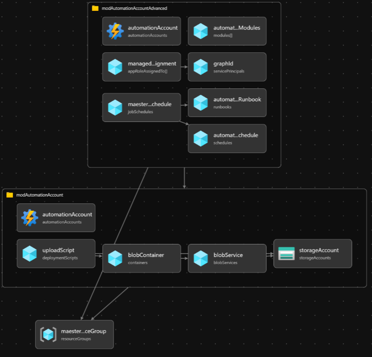
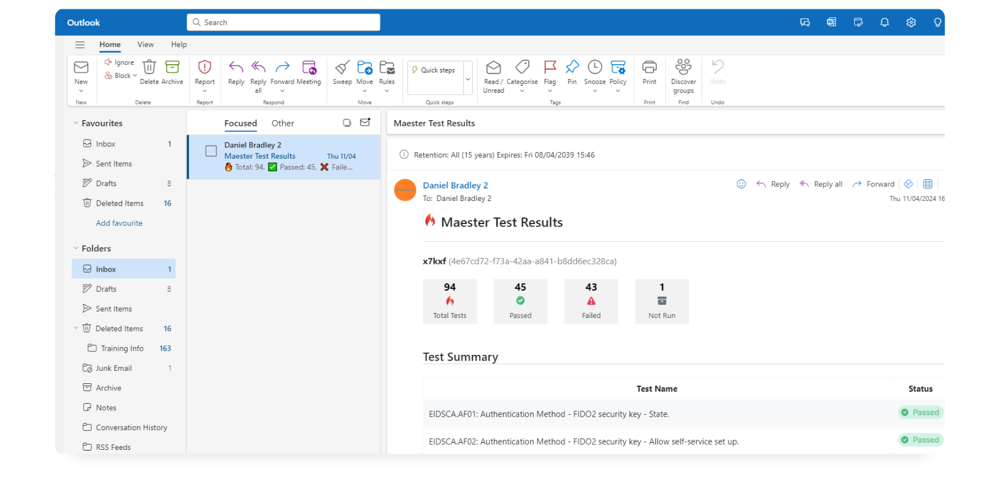

import GraphPermissions from '../sections/permissions.md';
import PrivilegedPermissions from '../sections/privilegedPermissions.md';

# <IIcon icon="devicon:azure" height="48" /> Setup Aura in Azure Automation using Azure Bicep

This guide will demonstrate how to get started with Aura and provide an Azure Bicep template to automate the deployment of Aura with Azure Automation.
- This setup will enable you to perform monthly security configuration checks on your Microsoft tenant and receive email alerts 🔥

## Why Azure Automation & Azure Bicep?

Azure Automation provides a simple and effective method to automate email reporting with Aura. Azure Automation has a free-tier option, giving you up to 500 minutes of execution each month without additional cost. Azure Bicep is a domain-specific language that uses declarative syntax to deploy Azure resources. It simplifies the process of defining, deploying, and managing Azure resources. Here’s why Azure Bicep stands out:
- **Simplified Syntax**: Bicep provides concise syntax, reliable type safety, and support for reusing code.easier to read.
- **Support for all resource types and API versions**: Bicep immediately supports all preview and GA versions for Azure services.
- **Modular and Reusable**: Bicep enables the creation of modular templates that can be reused across various projects, ensuring consistency and minimizing duplication.



### Pre-requisites

- If this is your first time using Microsoft Azure, you must set up an [Azure Subscription](https://learn.microsoft.com/azure/cost-management-billing/manage/create-subscription) so you can create resources and are billed appropriately.
- You must have the **Global Administrator** role in your Entra tenant. This is so the necessary permissions can be consented to the Managed Identity.
- You must also have Azure Bicep & Azure CLI installed on your machine, this can be easily done with, using the following commands:

```PowerShell
winget install -e --id Microsoft.AzureCLI
winget install -e --id Microsoft.Bicep
```

## Template Walkthrough
This section will guide you through the templates required to deploy Aura on Azure Automation Accounts. Depending on your needs, this can be done locally or through CI/CD pipelines.
- For instance, using your favorite IDE such as VS Code.
- Alternatively, through Azure DevOps.

To be able to declare Microsoft Graph resources in a Bicep file, you need to specify the Microsoft Graph Bicep type versions by configuring ```bicepconfig.json```

```json
  {
    "extensions": {
      "microsoftGraphV1": "br:mcr.microsoft.com/bicep/extensions/microsoftgraph/v1.0:1.0.0"
    }
  }
```

The ```main.bicepparam``` template defines our input parameters, such as the environment, customer, location, and app roles for the Managed Identity (MI).

```bicep
using 'main.bicep'

// Defing our input parameters
param __env__ = 'prod'
param __cust__ = 'ct'
param __location__ = 'westeurope'
param __auraAppRoles__ = [
  'Directory.Read.All'
  'DirectoryRecommendations.Read.All'
  'IdentityRiskEvent.Read.All'
  'Policy.Read.All'
  'Policy.Read.ConditionalAccess'
  'Reports.Read.All'
  'RoleEligibilitySchedule.Read.Directory'
  'RoleManagement.Read.All'
  'RoleManagementAlert.Read.Directory'
  'SecurityIdentitiesSensors.Read.All'
  'SecurityIdentitiesHealth.Read.All'
  'SharePointTenantSettings.Read.All'
  'ThreatHunting.Read.All'
  'UserAuthenticationMethod.Read.All'
  'Mail.Send'
]

param __auraAutomationAccountModules__ = [
  {
    name: 'Aura'
    uri: 'https://www.powershellgallery.com/api/v2/package/Aura'
  }
  {
    name: 'Microsoft.Graph.Authentication'
    uri: 'https://www.powershellgallery.com/api/v2/package/Microsoft.Graph.Authentication'
  }
  {
    name: 'Pester'
    uri: 'https://www.powershellgallery.com/api/v2/package/Pester'
  }
  {
    name: 'NuGet'
    uri: 'https://www.powershellgallery.com/api/v2/package/NuGet'
  }
  {
    name: 'PackageManagement'
    uri: 'https://www.powershellgallery.com/api/v2/package/PackageManagement'
  }
]
```

The ```main.bicep``` template serves as the entry point for our Bicep configuration. It defines the parameters and variables used across the various modules.

```bicep
metadata name = 'Aura Automation as Code <3'
metadata description = 'This Bicep code deploys Aura Automation Account with modules and runbook for automated report every month via e-mail'
metadata owner = 'Aura'
metadata version = '1.0.0'

targetScope = 'subscription'

extension microsoftGraphV1

@description('Defing our input parameters')
param __env__ string
param __cust__ string
param __location__ string
param __auraAppRoles__ array
param __auraAutomationAccountModules__ array

@description('Defining our variables')
var _auraResourceGroupName_ = 'rg-aura-${__env__}'
var _auraAutomationAccountName_ = 'aa-aura-${__env__}'
var _auraStorageAccountName_ = 'sa${__cust__}aura${__env__}'
var _auraStorageBlobName_ = 'aura'
var _auraStorageBlobFileName_ = 'aura.ps1'

@description('Resource Group Deployment')
resource auraResourceGroup 'Microsoft.Resources/resourceGroups@2023-07-01' = {
  name: _auraResourceGroupName_
  location: __location__
}

@description('Module Deployment')
module modAutomationAccount './modules/aa.bicep' = {
  name: 'module-automation-account-deployment'
  params: {
    __location__: __location__
    _auraAutomationAccountName_: _auraAutomationAccountName_
    _auraStorageAccountName_: _auraStorageAccountName_
    _auraStorageBlobName_: _auraStorageBlobName_
    _auraStorageBlobFileName_: _auraStorageBlobFileName_
  }
  scope: auraResourceGroup
}

module modAutomationAccountAdvanced './modules/aa-advanced.bicep' = {
  name: 'module-automation-account-advanced-deployment'
  params: {
    __location__: __location__
    __ouAuraAutomationMiId__: modAutomationAccount.outputs.__ouAuraAutomationMiId__
    __ouAuraScriptBlobUri__: modAutomationAccount.outputs.__ouAuraScriptBlobUri__
    _auraAutomationAccountName_: _auraAutomationAccountName_
    __auraAppRoles__:  __auraAppRoles__
    __auraAutomationAccountModules__: __auraAutomationAccountModules__

  }
  scope: auraResourceGroup
}

```

The ```aa.bicep``` module-file, automates the deployment of the Aura Azure Automation Account, a Storage Account, a container and uploads the Aura script to the Blob Container, which will be later used as input for our PowerShell runbook for the automation account to generate a security report.

```bicep
param __location__ string
param _auraAutomationAccountName_ string
param _auraStorageAccountName_ string
param _auraStorageBlobName_ string
param _auraStorageBlobFileName_ string

@description('Automation Account Deployment')
resource automationAccount 'Microsoft.Automation/automationAccounts@2023-11-01' = {
  name: _auraAutomationAccountName_
  location: __location__
  identity: {
    type: 'SystemAssigned'
  }
  properties: {
    sku: {
      name: 'Basic'
    }
  }
}

resource storageAccount 'Microsoft.Storage/storageAccounts@2022-09-01' = {
  name: _auraStorageAccountName_
  location: __location__
  sku: {
    name: 'Standard_LRS'
  }
  kind: 'StorageV2'
  properties: {
    accessTier: 'Hot'
    allowBlobPublicAccess: true
    networkAcls: {
      defaultAction: 'Allow'
    }
  }

}

@description('Create Blob Service')
resource blobService 'Microsoft.Storage/storageAccounts/blobServices@2022-09-01' = {
  parent: storageAccount
  name: 'default'
}

@description('Create Blob Container')
resource blobContainer 'Microsoft.Storage/storageAccounts/blobServices/containers@2022-09-01' = {
  parent: blobService
  name: _auraStorageBlobName_
  properties: {
    publicAccess: 'Blob'
  }
}

@description('Upload .ps1 file to Blob Container using Deployment Script')
resource uploadScript 'Microsoft.Resources/deploymentScripts@2020-10-01' = {
  name: 'deployscript-upload-blob-aura'
  location: __location__
  kind: 'AzureCLI'
  properties: {
    azCliVersion: '2.26.1'
    timeout: 'PT5M'
    retentionInterval: 'PT1H'
    environmentVariables: [
      {
        name: 'AZURE_STORAGE_ACCOUNT'
        value: storageAccount.name
      }
      {
        name: 'AZURE_STORAGE_KEY'
        secureValue: storageAccount.listKeys().keys[0].value
      }
      {
        name: 'CONTENT'
        value: loadTextContent('../pwsh/aura.ps1')
      }
    ]
    scriptContent: 'echo "$CONTENT" > ${_auraStorageBlobFileName_} && az storage blob upload -f ${_auraStorageBlobFileName_} -c ${_auraStorageBlobName_} -n ${_auraStorageBlobFileName_}'
  }
  dependsOn: [
    blobContainer
  ]
}

@description('Outputs')
output __ouAuraAutomationMiId__ string = automationAccount.identity.principalId
output __ouAuraScriptBlobUri__ string = 'https://${_auraStorageAccountName_}.blob.${environment().suffixes.storage}/${_auraStorageBlobName_}/aura.ps1'

```

The ```aa-advanced.bicep``` module file automates the configuration of the Aura Azure Automation Account by setting up role assignments, installing necessary PowerShell modules, creating a runbook, defining a schedule, and associating the runbook with the schedule. This configuration enables Aura to run automatically in Azure according to the specified schedule. This module is separate due to the need for replicating the Managed Service Identity (MSI) in Entra ID. By dividing the configuration into two module files, we can add the API consents 💪🏻


```bicep
extension microsoftGraphV1
param __location__ string
param __auraAppRoles__ array
param __auraAutomationAccountModules__ array
param __ouAuraAutomationMiId__ string
param __ouAuraScriptBlobUri__ string
param _auraAutomationAccountName_ string
param __currentUtcTime__ string = utcNow()

@description('Role Assignment Deployment')
resource graphId 'Microsoft.Graph/servicePrincipals@v1.0' existing = {
  appId: '00000003-0000-0000-c000-000000000000'
}

resource managedIdentityRoleAssignment 'Microsoft.Graph/appRoleAssignedTo@v1.0' = [for appRole in __auraAppRoles__: {
    appRoleId: (filter(graphId.appRoles, role => role.value == appRole)[0]).id
    principalId: __ouAuraAutomationMiId__
    resourceId: graphId.id
}]

@description('Existing Automation Account')
resource automationAccount 'Microsoft.Automation/automationAccounts@2023-11-01' existing = {
  name: _auraAutomationAccountName_
}

@description('PowerShell Modules Deployment')
resource automationAccountModules 'Microsoft.Automation/automationAccounts/modules@2023-11-01' = [ for module in __auraAutomationAccountModules__: {
  name: module.name
  parent: automationAccount
  properties: {
    contentLink: {
      uri: module.uri
    }
  }
}]

@description('Runbook Deployment')
resource automationAccountRunbook 'Microsoft.Automation/automationAccounts/runbooks@2023-11-01' = {
  name: 'runBookAura'
  location: __location__
  parent: automationAccount
  properties: {
    runbookType: 'PowerShell'
    logProgress: true
    logVerbose: true
    description: 'Runbook to execute Aura report'
    publishContentLink: {
      uri: __ouAuraScriptBlobUri__
    }
  }
}

@description('Schedule Deployment')
resource automationAccountSchedule 'Microsoft.Automation/automationAccounts/schedules@2023-11-01' = {
  name: 'scheduleAura'
  parent: automationAccount
  properties: {
    expiryTime: '9999-12-31T23:59:59.9999999+00:00'
    frequency: 'Month'
    interval: 1
    startTime: dateTimeAdd(__currentUtcTime__, 'PT1H')
    timeZone: 'W. Europe Standard Time'
  }
}

@description('Runbook Schedule Association')
resource auraRunbookSchedule 'Microsoft.Automation/automationAccounts/jobSchedules@2024-10-23' = {
  name: guid(automationAccount.id, 'runbook', 'schedule')
  parent: automationAccount
  properties: {
    parameters: {}
    runbook: {
      name: automationAccountRunbook.name
    }
    schedule: {
      name: automationAccountSchedule.name
    }
  }
}
```

The PowerShell script as part of the Automation Runbook for a simple and effective method to automate email reporting with Aura.
```PowerShell
#Connect to Microsoft Graph with System-Assigned Managed Identity
Connect-MgGraph -Identity

#Define mail recipient
$MailRecipient = "admin@tenant.com"

#create output folder
$date = (Get-Date).ToString("yyyyMMdd-HHmm")
$FileName = "AuraReport" + $Date + ".zip"

$TempOutputFolder = $env:TEMP + $date
if (!(Test-Path $TempOutputFolder -PathType Container)) {
    New-Item -ItemType Directory -Force -Path $TempOutputFolder
}

#Run Aura report
cd $env:TEMP
md aura-tests
cd aura-tests
Install-AuraTests .\tests
Invoke-Aura -MailUserId $MailRecipient -MailRecipient $MailRecipient -OutputFolder $TempOutputFolder
```


## Deployment

- You have the flexibility to deploy either based on deployment stacks or directly to the Azure Subscription.
- Using Deployment Stacks allows you to bundle solutions into a single package, offering several advantages
  - Management of resources across different scopes as a single unit
  - Securing resources with deny settings to prevent configuration drift
  - Easy cleanup of development environments by deleting the entire stack


Directly deployed based:
```PowerShell
#Connect to Azure
Connect-AzAccount

#Getting current context to confirm we deploy towards right Azure Subscription
Get-AzContext

# If not correct context, change, using:
# Get-AzSubscription
# Set-AzContext -SubscriptionID "ID"

#Deploy to Azure Subscription
New-AzSubscriptionDeployment -Name Aura -Location WestEurope -TemplateFile .\main.bicep -TemplateParameterFile .\main.bicepparam
```

Deployment Stack based:
```PowerShell
#Connect to Azure
Connect-AzAccount

#Getting current context to confirm we deploy towards right Azure Subscription
Get-AzContext

# If not correct context, change, using:
# Get-AzSubscription
# Set-AzContext -SubscriptionID "ID"

#Change DenySettingsMode and ActionOnUnmanage based on your needs..
New-AzSubscriptionDeploymentStack -Name Aura -Location WestEurope -DenySettingsMode None -ActionOnUnmanage DetachAll -TemplateFile .\main.bicep -TemplateParameterFile .\main.bicepparam
```

## Viewing the test results



## FAQ / Troubleshooting

- Ensure you have the latest version of Azure Bicep, as the ```microsoftGraphV1``` module depends on the newer versions

## Contributors

- Original author: [Daniel Bradley](https://www.linkedin.com/in/danielbradley2/) | Microsoft MVP
- Co-author: [Brian Veldman](https://www.linkedin.com/in/brian-veldman/) | Technology Enthusiast
